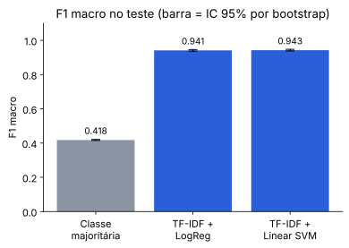
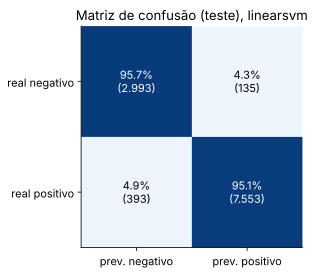

# ML Model Lab: sentimento em português (B2W-Reviews01)

Pipeline reprodutível de classificação de sentimento (positivo × negativo) em reviews reais de e-commerce em PT-BR:
análise exploratória, preparação sem vazamento, baselines, avaliação com intervalo de confiança, análise de erros
e gráficos. Inclui um ensaio de fine-tuning do Transformer BERTimbau (20 mil exemplos, 1 época, no Colab).

> **Teste a demo agora, sem instalar nada:** https://huggingface.co/spaces/marinaclara/sentimento-ptbr-b2w
>
> Escreva uma review em português e veja a classificação. É o baseline TF-IDF + Linear SVM rodando **no seu navegador**
> (o texto não é enviado a nenhum servidor). Não é o BERTimbau: ver os resultados abaixo.

## Status real

| Item | Status |
|---|---|
| Análise exploratória e 5 gráficos SVG | Feito (`charts/`) |
| Preparação (limpeza, duplicatas, conflitos, divisão por autor) | Feito e testado |
| Baselines: classe majoritária, TF-IDF + LogReg, TF-IDF + Linear SVM | Treinados e avaliados em 30 s numa CPU |
| Bootstrap (IC 95%), subgrupos e análise de erros | Feito |
| Transformer (BERTimbau): fine-tuning e avaliação | **Executado no Colab (GPU T4)** com 20.000 exemplos e 1 época: `results/metrics_transformer.json`. O treino completo (88.692 exemplos, 2 épocas) **não foi executado** |
| Modelo BERTimbau no Hugging Face Hub | Notebook e scripts prontos; **publicação pendente** (troque esta linha pelo link depois de publicar) |
| Demo gratuita (Space estático): `space-static/` | **Publicada:** https://huggingface.co/spaces/marinaclara/sentimento-ptbr-b2w. O modelo TF-IDF + SVM foi exportado para JSON e refeito em JavaScript; **igualdade com o scikit-learn testada** em 4.011 textos reais (diferença máxima 0,000014; 0 rótulos diferentes) |

## Como reproduzir

```bash
pip install -r requirements.txt
python -m model_lab.train       # baixa o dataset (verifica hash), treina, grava results/metrics.json
python -m model_lab.charts      # gera charts/*.svg a partir do metrics.json
python -m model_lab.export_static   # regenera space-static/model.json (demo no navegador)
# Transformer (precisa de GPU): abra notebooks/colab_bertimbau.ipynb no Google Colab
python -m pytest -q             # 12 testes (1 exige torch e é pulado sem ele)
```
Semente fixa (42): rodar de novo reproduz os números (conferi após refatorar o código).

## Dados

* **B2W-Reviews01** (B2W Digital, STIL 2019): 132.373 reviews. Licença **CC BY-NC-SA 4.0** (ver "Licença").
* Rótulo pela **nota**: 1-2 = negativo, 4-5 = positivo, 3 descartada. Entrada: **apenas o texto da review** (título,
  marca, idade, gênero e estado ficam de fora: o título vaza o sentimento e os demográficos criam risco de viés).
* Limpeza: 132.373 → 129.098 (sem texto) → 113.088 (sem nota 3) → **110.859** (2.227 duplicatas e 1 texto de rótulos conflitantes removidos).
* Divisão 80/10/10 **por autor**: treino 88.692, validação 11.093, teste 11.074. Autores compartilhados entre conjuntos: **0**.
  Positivos: 70,4% / 71,4% / 71,8%.
* **Não controlado:** produtos. 69,9% do teste fala de produtos que também aparecem no treino.

## Resultados reais (teste, `results/metrics.json`)

| Modelo | Acurácia | F1 macro (IC 95%) | ROC-AUC | Recall negativo | Precisão negativo |
|---|---|---|---|---|---|
| Classe majoritária | 0,7175 | 0,418 (0,415 a 0,421) | 0,500 | 0,000 | 0,000 |
| TF-IDF + Regressão Logística (C=4) | 0,9513 | 0,941 (0,937 a 0,946) | 0,986 | 0,954 | 0,883 |
| TF-IDF + Linear SVM (C=0,3) | 0,9523 | 0,943 (0,938 a 0,947) | 0,986 | 0,957 | 0,884 |
| BERTimbau ajustado (20.000 exemplos, 1 época) | 0,9617 | 0,953 (0,949 a 0,957) | 0,989 | 0,942 | 0,924 |

* **BERTimbau (Colab, T4, 158 s no total):** F1 macro 0,953 contra 0,943 do melhor baseline. O IC 95% do Transformer (0,949 a 0,957) **não se sobrepõe** ao do SVM (0,938 a 0,947), uma diferença de cerca de +0,011.
  **Ressalvas:** treinou com só 20.000 exemplos (22,5% do treino) e 1 época; é uma única execução (uma semente); usa perda sem `class_weight` e limiar 0,5, enquanto os baselines usam `class_weight=balanced`; o IC reflete só a amostragem do teste; não fiz teste pareado. O recall da classe negativa é **menor** (0,942 contra 0,957), embora a precisão seja maior (0,924 contra 0,884).
  O treino completo **não foi executado**; estimo que caiba em poucas dezenas de minutos na mesma GPU (extrapolação do tempo medido, não medição).
* **A acurácia engana:** quem sempre responde "positivo" já tem 71,8% de acurácia. Por isso a métrica principal é o F1 macro.
* **LogReg e SVM empatam:** a diferença de F1 macro (LogReg menos SVM) é −0,0013, com IC 95% de −0,0029 a +0,0003, que inclui zero.
  O SVM foi o "escolhido" por 0,0001 de F1 na validação (0,9434 contra 0,9433): na prática, é desempate, não superioridade.
* Hiperparâmetros escolhidos só na validação; o teste foi usado uma vez.



### Onde o modelo erra

* **Taxa de erro geral: 4,8%.** Textos com contraste ("mas", "porém", "entretanto") erram **11,4%** contra 3,7% sem contraste;
  textos com negação erram 8,1% contra 3,1%. Um modelo de n-gramas lê palavras, não a estrutura do argumento.
* **Por tamanho do texto (F1 macro):** até 5 palavras 0,865 (n=112, amostra pequena), 6-20 palavras 0,948, 21-60 0,926, mais de 60 0,894.
* **Por categoria de produto (6 maiores):** de 0,923 (TV e Home Theater) a 0,953 (Eletroportáteis).



### Rótulo ruidoso: o achado mais importante

Os erros em que o modelo estava **mais convicto** parecem **erros do rótulo**, não do modelo: reviews que elogiam
("Produto excelente, recomendo, e chegou antes do prazo!") com nota 1 ou 2, e reclamações graves ("péssima qualidade… não
obtive resposta") com nota 5. Nos 8 exemplos que li (`analise_de_erros` no `metrics.json`), todos tinham essa inconsistência.
**Não quantifiquei** a proporção de rótulos ruidosos (exigiria anotação humana), mas isso implica que o teto de acurácia
com rótulo por nota é menor que 100% e que parte do "erro" de 4,8% é do dado.

## Limitações

* Rótulo "fraco" (nota), com ruído não medido. Sem anotação humana.
* Só e-commerce brasileiro: não generaliza sem teste para outros domínios (redes sociais, jornalismo), gírias novas ou sarcasmo.
* Binário: sem classe neutra (a nota 3 foi descartada).
* Produtos compartilhados entre treino e teste (70%) podem inflar levemente o resultado.
* **Transformer:** só o ensaio com 20.000 exemplos e 1 época foi executado; o treino completo e a publicação no Hugging Face ainda não.

## Licença e uso do modelo (decisão sua)

O dataset é **CC BY-NC-SA 4.0**: exige crédito à **B2W Digital**, **uso não comercial** e distribuição de derivados sob a mesma
licença. Um modelo treinado nele, se publicado, deve seguir isso (`license: cc-by-nc-sa-4.0` no model card). Para portfólio
isso é aceitável; **não use o modelo em produto comercial**. O `publish_hf.py` só roda com `--eu-autorizo-publicar`.

## Publicar o modelo no Hugging Face (passo a passo)

1. Crie conta em huggingface.co e um token **Write** (Settings → Access Tokens). No Colab, guarde-o em **Secrets** como `HF_TOKEN`.
2. Abra `notebooks/colab_bertimbau.ipynb` no Colab, escolha **GPU (T4)** e rode as células em ordem: teste do código, ensaio com 20 mil exemplos, treino completo.
3. `python -m model_lab.make_card_transformer --usuario SEU_USUARIO` gera o model card **a partir do `metrics_transformer.json`** (nenhum número digitado à mão; o veredito "melhor/igual/pior" é calculado pelos intervalos de confiança).
4. `python -m model_lab.publish_hf --repo SEU_USUARIO/bertimbau-sentimento-b2w --simular` mostra o que seria enviado.
5. Só então `--eu-autorizo-publicar`. O repositório nasce **público**.
6. Abra a página do modelo, teste o widget de inferência e coloque o link neste README e no perfil.

**Se o Transformer não superar o baseline, publique mesmo assim**, e o card dirá isso. Um resultado honesto vale mais que um inflado.

## Estrutura

```
space-static/  demo que roda no navegador (index.html, modelo.js, model.json)
model_lab/  data.py (download + hash), prep.py, train.py, charts.py, transformer_finetune.py*, publish_hf.py*
charts/     5 SVGs individuais     results/  metrics.json     tests/  5 testes     * = não executado
```